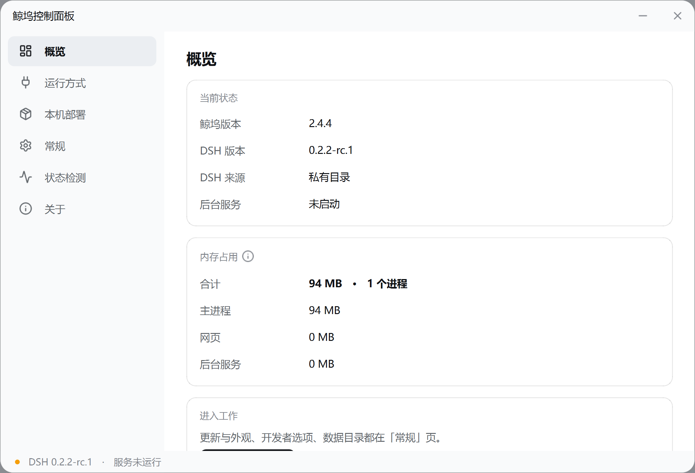
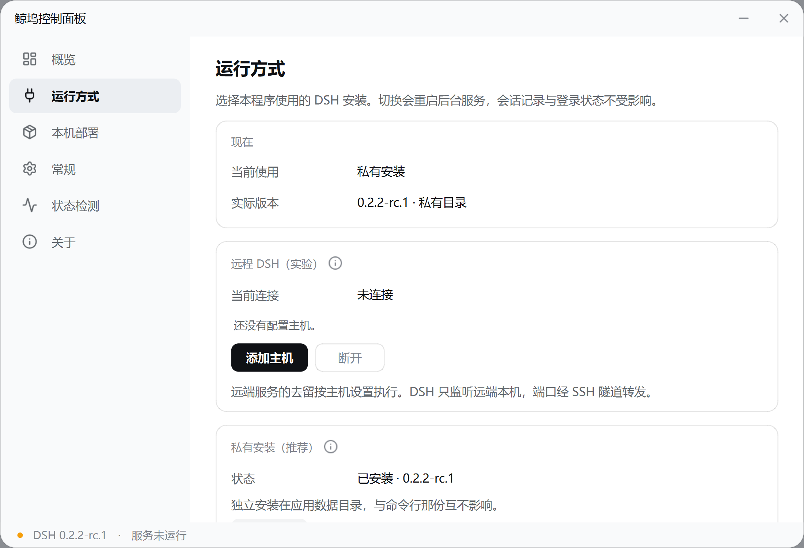

<h1 align="center">鲸坞</h1>

<p align="center">
  <b>DeepSeek Harness 的 Windows 桌面客户端</b><br>
  双击即可运行：原生窗口里的 DSH Web UI，不必敲命令、不必处理端口与令牌。
</p>

<p align="center">
  <a href="https://github.com/pudaa/dsh-launcher/releases"></a>
  
  
</p>

<p align="center">
  
</p>

## 它解决什么问题

DSH 官方只提供 CLI。要使用 Web UI，需要自行在终端执行 `dsh web`，从输出里复制带 token 的长地址粘贴到浏览器；终端关闭后服务随之终止，下次重新来过。

鲸坞把这套流程收进一个窗口：

- **不必记命令** —— 双击启动，服务自动拉起
- **不必复制令牌** —— 地址从服务输出解析，直接加载
- **关闭窗口不终止服务** —— 后台任务继续运行，下次打开直接接管
- **未安装 DSH 也可使用** —— 内置引导，经官方渠道安装 Node 与 DSH
- **更新有据可查** —— 更新前后比对数据指纹，会话与登录状态不受影响

## 功能

| 功能 | 说明 |
|---|---|
| 一键启动 | 自动定位 DSH、规划端口、拉起服务、加载界面 |
| 服务接管 | 端口已有本程序的实例时直接接管，不重复启动 |
| 端口冲突处理 | 约定端口被占用且响应不似 DSH 时，改用系统分配的端口 |
| 环境自检 | 启动前诊断 Node / npm / DSH 三项状态 |
| 首次运行引导 | 缺少 Node 经 winget 官方渠道安装；DSH 装入私有 prefix，不改动全局环境 |
| 运行方式 | 私有安装与命令行共用两种模式，可切换；切换重启服务，会话与登录状态保留 |
| DSH 更新 | 走官方 npm 通道，覆盖稳定 / 候选 / 尝鲜三条版本线，支持一键回归稳定版 |
| 通道透明 | 即使已是最新，也会报告预览通道是否存在更高版本 |
| 内存占用 | 概览页按进程树列出主进程 / 网页 / 后台服务的私有内存与合计 |
| 远程 DSH | 经 SSH 隧道使用另一台机器上的 DSH（实验性，见下） |
| 控制面板 | 自绘窗口（880×600、无边框、圆角）：概览 / 运行方式 / 本机部署 / 常规 / 状态检测 / 关于 |
| 外链处理 | 异源链接交给系统浏览器，同源留在窗口内；`target="_blank"` 不再无响应 |
| 开发者模式 | 打开 Chromium 自带的开发者工具（Elements / Console / Network / Sources），关窗即释放；另有终端页，可查看打包后的进程输出 |
| 配色跟随 | 明暗两套配色取自 DSH 官方前端的语义令牌，跟随界面主题切换 |
| 鲸坞更新 | 从 GitHub Release 拉取新版本，自动替换并重启 |
| 应用内反馈 | 操作结果均呈现在窗口内，不依赖系统通知 |

### 托盘菜单

```
显示主窗口
控制面板…
────────────────
检查 DSH 更新…
检查鲸坞更新…
────────────────
打开日志目录
关于鲸坞
────────────────
退出
```

托盘只保留一步到位的动作。设置项与有风险的版本管理操作（加入预览计划、标题栏跟随配色、回归稳定版、回滚、准备运行环境）都放在控制面板里。

两组更新刻意分开：**DSH 更新**替换的是 DSH 程序（npm），**鲸坞更新**替换的是正在运行的 exe（GitHub Release），两者互不影响。

「退出」会一并停止后台服务。若希望服务继续运行，关闭窗口（最小化到托盘）即可，不要退出。

## 快速开始

### 使用现成的 exe

到 [Releases](https://github.com/pudaa/dsh-launcher/releases) 下载 `DSH-Web.exe`，双击运行。

若机器上尚未安装 Node 与 DSH，程序会弹出引导窗口逐步安装。首次安装 DSH 需下载五百余个包，约十几分钟，窗口内有进度。

### 从源码运行

```bash
pip install -r requirements.txt
python dsh_gui_qt.py
```

### 打包

```bash
python -m nuitka --onefile \
  --windows-console-mode=disable \
  --windows-icon-from-ico=assets/icon.ico \
  --enable-plugin=pyside6 \
  --include-package=dsh_host \
  --include-package=dsh_ui \
  --onefile-tempdir-spec={CACHE_DIR}/DSH-Web-runtime \
  --output-dir=build --output-filename=DSH-Web.exe \
  --lto=yes dsh_gui_qt.py
```

> 打包解释器须为 python.org 的独立环境。conda 系环境会让 Nuitka 报 `flavor 'Anaconda Python'`，其 PySide6 插件枚举 conda 元数据时以 `KeyError: 'files'` 直接崩溃。

### 发布

版本号只在 `dsh_host/version.py` 定义一次。修改后提交并打 tag：

```bash
# 1. 修改 dsh_host/version.py 里的 HOST_VERSION
# 2. 提交并打 tag
git commit -am "release: v2.4.4"
git tag -a v2.4.4 -m "v2.4.4 — 一句概述"
git push origin main v2.4.4
```

GitHub Actions 会运行自测、构建 exe、创建 Release。工作流校验 tag 与源码版本号一致，不一致即失败。

## 界面

<p align="center">
  
</p>

控制面板与主窗口共用同一套配色来源：标题栏从界面取色后推导明暗，面板据此切换。所有说明性内容收在标题右侧的 ⓘ 中，正文只保留结论。

## 架构

分三层，越往下越了解 DSH 的内部细节。上层不得越过下层，直接和 DSH 打交道。

```
┌───────────────────────────────────────────────┐
│  dsh_gui_qt.py         界面层                  │
│  Qt 窗口 / 托盘 / 引导 / 更新对话框            │
│  不出现任何 DSH 私有路径、文件名、日志格式     │
└────────────────────┬──────────────────────────┘
                     │ 只调用 dsh_host 的公开函数
┌────────────────────▼──────────────────────────┐
│  L2  dsh_host/updater.py     DSH 更新事务      │
│      dsh_host/selfupdate.py  鲸坞自更新        │
│      dsh_host/provision.py   环境供给          │
└────────────────────┬──────────────────────────┘
                     │
┌────────────────────▼──────────────────────────┐
│  L1  dsh_host/compat.py      版本适配表        │
│  区间覆盖 + 外部 compat.json 覆盖              │
└────────────────────┬──────────────────────────┘
                     │
┌────────────────────▼──────────────────────────┐
│  L0  dsh_host/contract.py    契约层  ★唯一     │
│      启动 / 就绪探测 / URL 解析 / 停止         │
│      环境自检 / 数据指纹                       │
│  dsh_host/config.py          路径定义  ★唯一   │
│  dsh_host/version.py         版本定义  ★唯一   │
└───────────────────────────────────────────────┘
```

**为何这样分层。** DSH 处于 developer preview，官方明确会有破坏性更新。任何依赖某个内部细节不变的写法都会在下次更新时失效。因此对 DSH 的全部假设收敛在 L0 一个文件里，并带有探测顺序与降级路径。

界面的美术规范另见 [`docs/ui-guidelines.md`](docs/ui-guidelines.md)：颜色、字体、圆角、间距、动效的官方令牌，以及 Web 规则到 Qt 样式表的对照表。

### 模块职责

| 文件 | 职责 |
|---|---|
| `dsh_host/config.py` | **所有路径的唯一权威定义处**。其余模块 import，禁止自行拼接 `LOCALAPPDATA` |
| `dsh_host/version.py` | **版本号与产品名的唯一定义处** |
| `dsh_host/contract.py` | L0 契约层。安装探测、服务启动、就绪等待、URL 解析、环境自检、数据指纹 |
| `dsh_host/compat.py` | L1 版本适配表。按 `major.minor.patch` 代数比较（DSH 所有 release 都是预发布，严格 semver 序会匹配不到） |
| `dsh_host/updater.py` | L2 DSH 更新事务。停服 → 取指纹 → 安装 → 校验 → 比对指纹 → 重启，失败自动回滚 |
| `dsh_host/selfupdate.py` | L2 鲸坞自更新。从 GitHub Release 下载、校验、生成替换脚本 |
| `dsh_host/provision.py` | L2 首次运行环境供给。winget 装 Node、私有 prefix 装 DSH |
| `dsh_host/remote.py` | 远程 DSH。经系统 OpenSSH 把远端 loopback 端口转发到本机 |
| `dsh_host/storage.py` | 数据目录的占用统计、迁移、清理 |
| `dsh_host/procmem.py` | 进程树内存采样（按私有内存，不看工作集） |
| `dsh_host/dwm.py` | 标题栏取色与边框推导（Windows 11） |
| `dsh_devtools.py` | 网页层策略与观测。外链出口判定、控制台与网络记录、开发者窗口 |
| `dsh_theme.py` | DSH 官方美术在 Qt 侧的转译层。字号、圆角、间距、动效、对话框样式 |
| `dsh_console.py` | 宿主进程输出采集。接管 fd 1/2，把打包后不可见的终端收进开发者面板 |
| `dsh_panel.py` | 控制面板。原生控件绘制，不用 WebEngine |
| `dsh_gui_qt.py` | 界面层。PySide6 + QtWebEngine |

## 远程 DSH（实验）

控制面板「运行方式」页可添加远程主机，经 SSH 使用另一台机器上的 DSH。

原则是**只借端口，不改绑定**：远端 DSH 仍然只监听 `127.0.0.1`，由 SSH 隧道把该端口转发到本机。官方将"只监听本机"作为安全边界（拒绝绑定 `0.0.0.0` 的理由是 RCE），本程序不去绕开它。

- 复用系统 OpenSSH：`~/.ssh/config` 中的别名、密钥、known_hosts 直接生效
- 不接受密码：认证交由系统 SSH，本程序不保存任何凭据
- 远端只在 `~/.dsh-remote/` 写入 pid、日志与启动命令；停止前核对进程启动时间，身份不符则不动手

**为何标为实验：** 该链路目前只验证到错误分类（连接失败时的提示是否正确）。"复用远端已启动的实例"一步尚未在真机验证。

## 目录规划

运行时数据分两处，互不干扰：

```
%LOCALAPPDATA%\DSH-Web\              鲸坞数据根（配置与登录态）
    settings.json / compat.json / install.json / service.json
    remote-hosts.json                远程主机列表（不含凭据）
    logs\{dsh-web.log, host.log}
    profile\                         QtWebEngine 登录态
    node-global\                     私有 npm prefix

%LOCALAPPDATA%\DSH-Web-runtime\      Nuitka onefile 解包目录（纯缓存）
```

拆开的原因：此前两者是同一目录，清缓存（排障标准动作）会连带丢失登录态与配置。现在删除 `DSH-Web-runtime\` 永远安全，删除 `DSH-Web\` 才会丢失配置。

**鲸坞自有数据永不写入 `DSH_HOME`。** `DSH_HOME` 属于 DSH，本程序只读（唯一例外是清理陈旧的 `.credentials.yaml.lock`）。

## 开发

### 自测

```bash
# 契约层：版本代数、路径反推、URL 解析、远程脚本
DSH_SELFTEST_LITE=1 python tools/contract_selftest.py

# 无头 GUI：面板构造、菜单结构、数据任务
DSH_GUI_SELFTEST_STATIC=1 python tools/gui_selftest.py

# 数据操作冒烟：清缓存 / 迁移 / 失败路径
python tools/datatask_smoke.py
```

远程脚本另有独立的本地冒烟（用本机 sh 扮演远端，不需要真的 SSH）：

```bash
python tools/remote_script_smoke.py
```

### 日志

`%LOCALAPPDATA%\DSH-Web\logs\`：

- `host.log` —— 鲸坞自身的操作记录（启动、检查更新、安装、回滚）
- `dsh-web.log` —— DSH 服务进程的原始输出
- `mem.log` —— 每分钟一行的内存采样（私有 / 工作集 / JS 堆 / DOM 数）

## 已知限制

- **仅支持 Windows。** 服务生命周期管理使用 `DETACHED_PROCESS`、winget 与注册表读取 PATH。
- **应用被强制结束时服务一并终止。** `DETACHED_PROCESS` 只脱离控制台，不脱离 Job Object。正常退出则服务随之停止。
- **回滚不保证数据格式可逆。** 自动回滚保护的是"能够启动"，不是"会话可读"。旧版本可能无法打开新版本写出的会话记录——记录不会被删除，只是读不了。
- **远程功能为实验状态。** 详见上文。

## 许可

本项目尚未声明开源许可证。在补充之前，默认保留所有权利。
